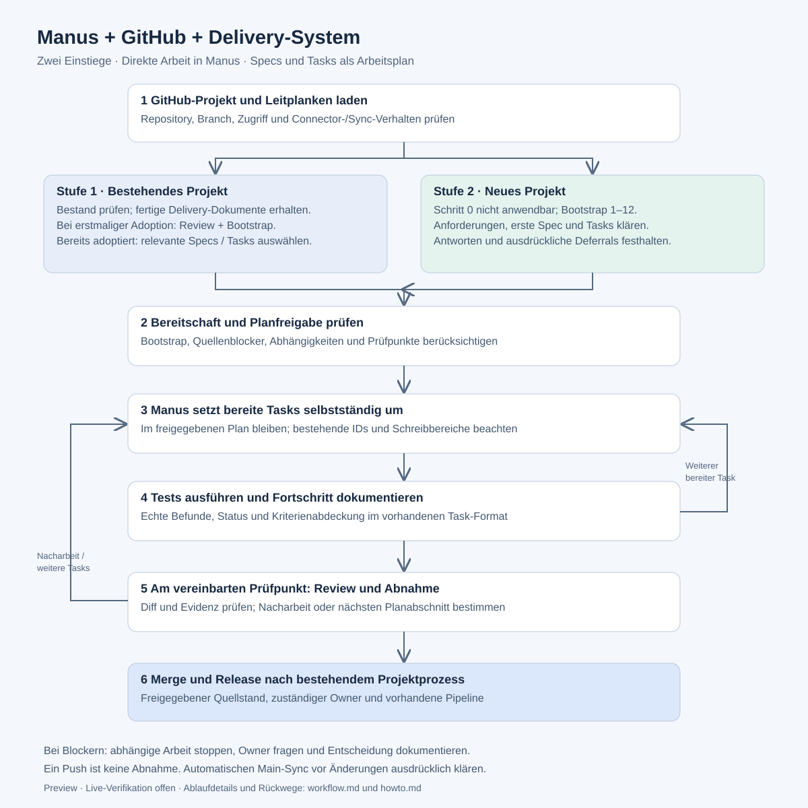

# Manus Delivery System Add-on

**Updated:** 2026-11-17 · **Status:** Preview; live verification in Manus pending.

Manus works directly with a GitHub project repository and uses its Delivery
System to clarify requirements, follow specs and tasks, build the application,
run checks, and document evidence. This package provides setup instructions,
project guidance, and a workflow. It installs no service and requires no external
Manus API or API credentials.

## Two Entry Levels

| Level | Starting point | Workflow |
| --- | --- | --- |
| **1 – Adopt an existing project** | Code and possibly delivery documents exist | Review the repository, fill structural gaps, and execute approved specs/tasks |
| **2 – Bootstrap a new project** | Project idea and an empty or newly created repository | Complete bootstrap, clarify requirements and initial specs/tasks, then implement |

Both levels run directly in Manus. They describe project entry points rather than
connection types. Preserve completed bootstrap in adopted projects. First-time
adoption must satisfy the existing bootstrap gates.

## Getting Started

1. Follow the [Manus how-to](howto.md) to verify GitHub access and the working mode.
2. Prepare the target project with the [integration prompt](integration-prompt.md).
3. Adapt the [project instructions](templates/manus-project-instructions.md), make
   them available in Manus, and verify actual repository reads.
4. Follow the appropriate entry level and define the approved implementation plan
   using the [implementation template](templates/implementation.md).
5. Verify both entry levels using the [test guide](test-guide.md).

Additional guidance: [operating rules](instructions.md), an optional
[research/drafting assignment](templates/assignment.md), and the
[deactivation prompt](deactivation-prompt.md).

## Workflow

The [workflow and Mermaid source](workflow.md) show both entry levels, blockers,
and the implementation loop through acceptance.

## Boundaries

Canonical project instructions and delivery documents remain authoritative.
Manus may independently execute multiple ready tasks within an approved plan.
Request another decision only when required by project rules, missing authority,
or an agreed checkpoint. Blockers prevent dependent work.

Verify GitHub access and the actual branch before changes. The how-to distinguishes
branch/PR work through the connector from web-app sync. Text instructions cannot
technically disable automatic sync. Commits, pushes, merges, and publication
follow project authorization. A push alone is neither acceptance nor a release.

Role profiles provide guidance; they do not automatically launch Manus subagents.
Do not assume automatic loading of `AGENTS.md` or other files. The start prompt
requires reading the actual sources. Verify instruction compliance in the project.

Keep a durable integration record under the existing documentation root. Installed
instructions must remain usable without removable `addons/` files. Do not populate
this template's project documents with invented adopter settings.

## Verification and Removal

Links, graphics, and templates can be checked locally. Account access, actual
repository reads, branch behavior, tests, and result quality require live checks.
The package remains a preview until those checks provide evidence.

Before deactivation, preserve pending work and results. Remove only add-on-owned
instructions and authorized access. Deleting `addons/manus/` stops neither Manus
nor an existing GitHub sync.
