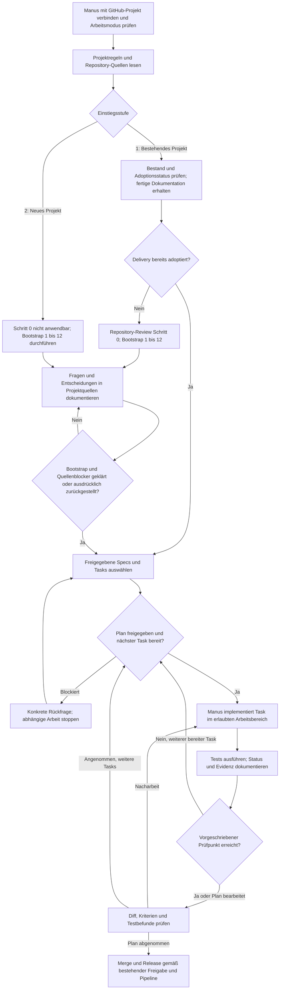

# Workflow: Manus baut im GitHub-Projekt nach dem Delivery-System

Beide Einstiegsstufen laufen direkt in Manus mit demselben Projektrepository.
Die Grafik zeigt die fachlichen Gates; Connector oder Sync sind Arbeitsmodi,
keine weiteren Integrationsstufen. Live-Verifikation steht noch aus.

## Bearbeitbare Diagrammquelle

## Übergaben und Fortsetzung

| Punkt | Verantwortung | Nachweis |
| --- | --- | --- |
| Einrichtung | Projekt-Owner | Repository, Modus, Branch, Zugriff, tatsächlich gelesene Regeln |
| Projektklärung | Fachlicher Owner; Manus bereitet vor | Bootstrap-Status, Antworten/Deferrals, freigegebene Quellen |
| Ausführung | Manus mit zuständigem Rollenprofil | Task-IDs, erlaubter Umfang, Diff und ausgeführte Checks |
| Abnahme | Nach Projektregeln zuständiger Prüfer/Owner | Kriterienabdeckung, DoD und vorgeschriebene Abnahme |
| Veröffentlichung | Bestehender Release-Owner | Freigegebener Commit und vorhandener Deployprozess |

Im freigegebenen Plan darf Manus ohne erneute Einzelbeauftragung weiterarbeiten.
Blocker, Abhängigkeiten und vereinbarte Abnahmen begrenzen die Fortsetzung. Eine
Deferral hebt nicht automatisch weitere Voraussetzungen auf. Im neuen Chat den
aktuellen Repository- und Aufgabenstand erneut lesen lassen.

Der dokumentierte Web-App-Sync kann Code bereits vor einer fachlichen Abnahme
übertragen. Deshalb dessen Verhalten vor Umsetzung klären; ein Push erfüllt
keine Abnahmekriterien. Details und Startprompts stehen im [How-to](howto.md).
