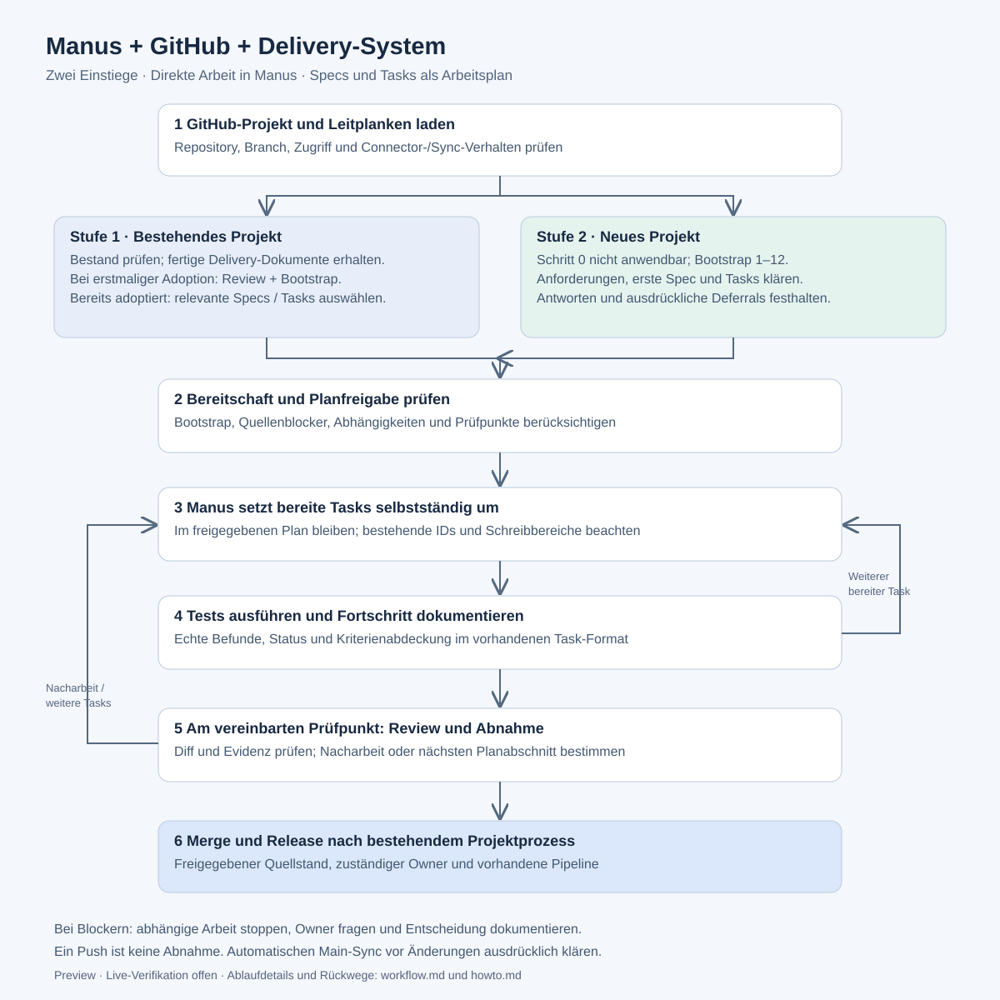
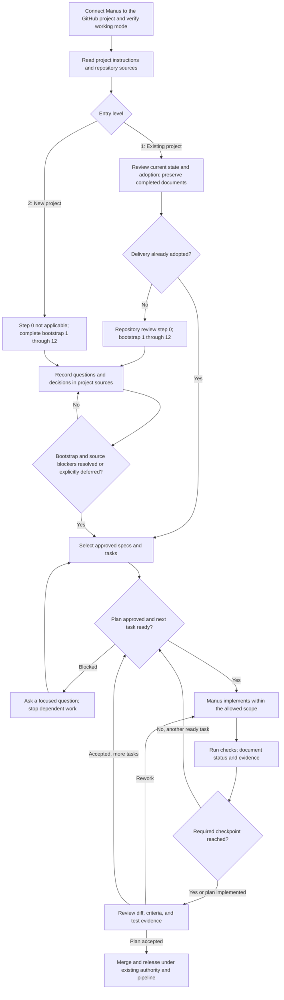

# Workflow: Manus Develops in GitHub Using the Delivery System

Both entry levels run directly in Manus with the same project repository.
The diagram shows delivery gates; connector and sync are working modes, not
additional integration levels. Live verification remains pending.

## Editable Diagram Source

## Handoffs and Resumption

| Point | Accountable role | Evidence |
| --- | --- | --- |
| Setup | Project owner | Repository, mode, branch, access, actual instruction reads |
| Project clarification | Domain owner; Manus prepares | Bootstrap status, answers/deferrals, approved sources |
| Execution | Manus following the relevant role profile | Task IDs, allowed scope, diff, and actual checks |
| Acceptance | Reviewer/owner under project rules | Criteria coverage, DoD, and required approval |
| Publication | Existing release owner | Approved commit and existing deployment process |

Within the approved plan, Manus may continue without another task assignment.
Blockers, dependencies, and agreed acceptance gates limit progression. A deferral
does not automatically remove other prerequisites. In a new chat, read the current
repository and task state again.

Documented web-app sync may transfer code before delivery acceptance. Establish
its behavior before implementation; a push does not satisfy acceptance criteria.
See the [how-to](howto.md) for details and start prompts.
